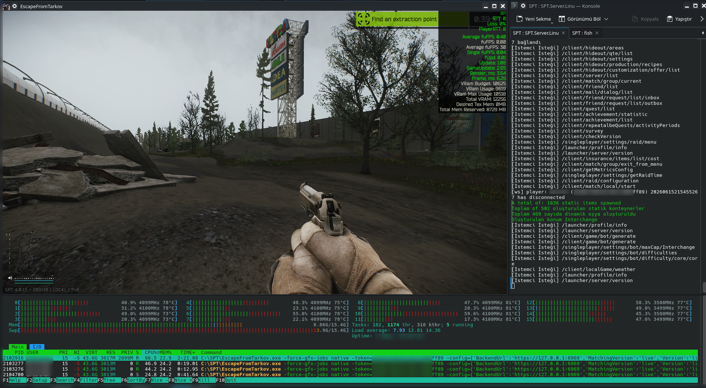
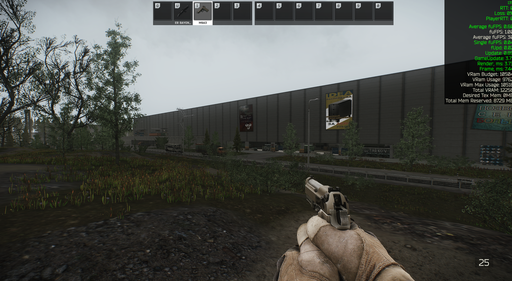

# SPT Linux (Lutris) Installation & Troubleshooting Guide


Bu kılavuz, Single Player Tarkov (SPT) kurulumunu Linux (Lutris) üzerinde sorunsuzca yapabilmeniz ve karşılaşılan kritik hataları (donma, beyaz ekran, çökme vb.) çözebilmeniz için hazırlanmıştır.

This guide is prepared to help you install Single Player Tarkov (SPT) on Linux (Lutris) smoothly and fix critical errors (freezing, white screen, crashes, etc.).

---

## Türkçe Rehber

### 1. Temel Gereksinimler & Kurulum

1. Orijinal Escape From Tarkov raw (spt yamasız) sürümünü bir klasöre çekin.

2. SPT ve downgrader yamalarını uygulayarak oyun sürümünü SPT ile uyumlu hale getirin.

3. Lutris üzerinden yeni bir Wine oyunu ekleyin.

> [!IMPORTANT]

> **Klasör Yapısı & Sonsuz Döngü Hatası (Çok Önemli):**

> Oyun dosyalarını doğrudan Wine Prefix'inin kök klasörüne (örneğin `/home/kullanici/Games/SPT/`) koyarsanız, Wine'ın otomatik oluşturduğu `dosdevices/x:` symlink'i (kısayolu) yüzünden BepInEx tarayıcısı sonsuz döngüye girer. Bu durum işlemciyi %100 kullanır ve Launcher'ın **"Oyunu Başlat"** butonuna basınca donmasına yol açar.

> **Çözüm:** Tüm oyun klasörünü Prefix içerisindeki `drive_c/SPT/` altına taşıyın. Launcher `config.json` dosyasındaki oyun yolunu `"C:\\SPT\\"` yapın.

### 2. Çalıştırıcı (Runner) Seçimi

* **Gereksinim:** UMU-Proton / Proton sürümleri, güvenlik kafesinden (sandbox) ötürü Launcher'ın oyunu başlatma sürecini kilitleyebilir.

* **Çözüm:** Lutris üzerinden **`wine-ge-8-26`** veya güncel bir **System Wine** çalıştırıcısını seçin.

### 3. Kritik Dll Overrides (Kayıt Defteri) Ayarları

Modların yüklenmesi ve başlatıcının çakışmaması için Wine kayıt defterine (`regedit` ile) şu girdileri ekleyin:

```ini

[HKEY_CURRENT_USER\Software\Wine\AppDefaults\EscapeFromTarkov.exe\DllOverrides]

"winhttp"="native,builtin"

[HKEY_CURRENT_USER\Software\Wine\AppDefaults\SPT.Launcher.exe\DllOverrides]

"winhttp"="builtin"

"mscoree"="builtin"

```

* **Neden?** `winhttp` küresel olarak ezilirse, .NET 9 kullanan Launcher'ın internet bağlantısı kopar ve çökebilir. `mscoree` ise oyunun kendi Mono motorunun yerine harici .NET yüklemeye çalışıp oyunu çökerteceği için oyun için kesinlikle kapatılmalıdır.

### 4. LAN / Harici Sunucu Kurulumu (Düşük RAM İçin İsteğe Başlı)

Hem SPT Sunucusunu hem de Oyunu aynı bilgisayarda çalıştırmak 16GB+ RAM tüketebilir ve 16GB RAM'e sahip sistemlerde çökmelere (out-of-memory) sebep olabilir. Sunucuyu yerel ağınızdaki (LAN) başka bir bilgisayara taşıyabilirsiniz:

1. **Sunucu Bilgisayarında:** `SPT_Data/database/server.json` dosyasını açıp `"ip": "127.0.0.1"` değerini `"ip": "0.0.0.0"` olarak değiştirin (bu, sunucunun yerel ağdaki diğer cihazlardan bağlantı kabul etmesini sağlar). Ardından `SPT.Server.exe`'yi başlatın.

2. **İstemci Bilgisayarında (Linux/Lutris):** `drive_c/SPT/SPT/user/launcher/config.json` dosyasını açıp `"Url": "https://127.0.0.1:6969"` değerini `"Url": "https://<SUNUCU_YAPILANDIRILMIS_LAN_IP_ADRESI>:6969"` olarak değiştirin.

3. Sunucu bilgisayarının güvenlik duvarında (firewall) `6969` (TCP) portuna gelen bağlantılara izin verildiğinden emin olun.

### 5. Olası Hatalar ve Çözümleri

#### A. Launcher Açılıyor ama Bembeyaz Kalıyor (Avalonia UI Hatası)

SPT Launcher, Avalonia UI kullanır ve Wine GPU hızlandırmasında sorun yaşarsa beyaz ekran kalır.

* **Çözüm:** Lutris -> Configure -> System Options -> Environment Variables kısmına şu değişkenleri ekleyin:

* `AVALONIA_RENDERER` = `software`

* `wpf_gfx_renderer` = `software`

#### B. Oyunu Başlatınca Doğrudan Kapanıyor ("Exiting..." Uyarısı)

* **Çözüm:** Oyunu doğrudan `EscapeFromTarkov.exe` dosyasından açmaya çalışıyorsunuz demektir. Güvenlik doğrulaması için oyun her zaman **Launcher üzerinden** başlatılmalıdır.

#### C. Oyun Çöktükten Sonra Arkada Kalan İşlemler (Yüksek CPU ve RAM Kullanımı)

Bazen oyun çöktüğünde `EscapeFromTarkov.exe`, `wineserver` veya `winedevice.exe` işlemleri arka planda asılı kalabilir ve işlemcinizi/raminizi tüketmeye devam edebilir.

* **Çözüm:** Bu işlemleri tek bir komutla temizlemek için terminalinizde şu komutu çalıştırın:

```bash

WINEPREFIX=/home/user/Games/SPT wineserver -k

```

*(Veya Lutris penceresinde SPTarkov oyununun altındaki yukarı oka tıklayıp **"Kill all Wine processes"** seçeneğini seçin).*

### 6. Performans ve Ekran Görüntüleri

Linux üzerinde SPT performansına dair ekran görüntüleri (Interchange haritasında 1080p ayarlarda 100+ FPS ve sistem kaynaklarının durumu):





---

## English Guide

### 1. Prerequisites & Installation

1. Place the original Escape From Tarkov raw files in a directory.

2. Apply the SPT patches and downgrader to make it compatible with the server.

3. Add a new Wine game in Lutris.

> [!IMPORTANT]

> **Directory Structure & Infinite Loop Bug (Crucial):**

> If you place the game files directly in the root of the WINEPREFIX (e.g. `/home/user/Games/SPT/`), the automatic `dosdevices/x:` symlink created by Wine will cause BepInEx to enter an infinite directory-scanning loop. This uses 100% CPU and causes the Launcher to freeze upon clicking **"Start Game"**.

> **Fix:** Move the entire game folder inside the prefix to `drive_c/SPT/`. Change the game path in the launcher's `config.json` to `"C:\\SPT\\"`.

### 2. Runner Selection

* **Constraint:** UMU-Proton / Proton runners can lock the process-spawning capability of the Launcher due to their sandbox (bubblewrap) isolation.

* **Fix:** Select **`wine-ge-8-26`** or a modern **System Wine** runner in Lutris settings.

### 3. Critical Dll Overrides (Registry Setup)

Add the following overrides to your Wine registry (`regedit`) to ensure BepInEx loads correctly without breaking the Launcher:

```ini

[HKEY_CURRENT_USER\Software\Wine\AppDefaults\EscapeFromTarkov.exe\DllOverrides]

"winhttp"="native,builtin"

[HKEY_CURRENT_USER\Software\Wine\AppDefaults\SPT.Launcher.exe\DllOverrides]

"winhttp"="builtin"

"mscoree"="builtin"

```

* **Why?** Globally overriding `winhttp` breaks the .NET 9-based Launcher's networking. Overriding `mscoree` to native on the game client crashes Unity's embedded Mono engine by forcing external .NET execution.

### 4. LAN / Dedicated Server Setup (Optional for Low RAM PCs)

Running both the SPT Server and the Game Client on the same PC can consume 16GB+ RAM, causing out-of-memory crashes on 16GB systems. You can offload the SPT Server to another PC in your local network:

1. **On the Server PC:** Open `SPT_Data/database/server.json` and change `"ip": "127.0.0.1"` to `"ip": "0.0.0.0"` (this allows the server to accept connections from other devices on the LAN). Start `SPT.Server.exe`.

2. **On the Client PC (Linux/Lutris):** Open `drive_c/SPT/SPT/user/launcher/config.json` and change `"Url": "https://127.0.0.1:6969"` to `"Url": "https://<YOUR_SERVER_LAN_IP>:6969"`.

3. Make sure to allow incoming connections on port `6969` (TCP) in the firewall of the server PC.

### 5. Troubleshooting & Common Errors

#### A. Launcher Opens to a Blank White Screen (Avalonia UI Bug)

The Launcher is built with Avalonia UI, which can fail to render using GPU acceleration under Wine.

* **Fix:** In Lutris -> Configure -> System Options -> Environment Variables, add:

* `AVALONIA_RENDERER` = `software`

* `wpf_gfx_renderer` = `software`

#### B. Game Shuts Down Instantly with "Exiting..."

* **Fix:** This happens when you try to run the game directly from `EscapeFromTarkov.exe`. The game client requires a security token from the launcher; therefore, you must always run it **via the Launcher**.

#### C. Lingering Processes After Crash (High CPU and RAM Usage)

Sometimes when the game crashes, processes like `EscapeFromTarkov.exe`, `wineserver`, or `winedevice.exe` remain hung in the background, consuming CPU and memory.

* **Fix:** To cleanly terminate all lingering Wine processes, run this command in your terminal:

```bash

WINEPREFIX=/home/user/Games/SPT wineserver -k

```

*(Or click the up arrow next to the Play button in Lutris and select **"Kill all Wine processes"**).*

### 6. Performance & Screenshots

Screenshots showcasing the SPT performance on Linux (100+ FPS on Interchange at 1080p, and system resource utilization):


